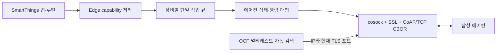

# 삼성 에어컨 로컬 Edge 드라이버 설계 초안

작성일: 2026-10-19. 갱신일: 2026-10-20, Asia/Seoul. 이 문서는 관찰한 사실, 제안하는 설계, 미검증 항목을 구분합니다.

## 1. 목표와 현재 판단

목표는 SmartThings 허브에서 에어컨까지의 제어 통신을 LAN으로 처리하는 것입니다. 드라이버 등록·배포와 앱의 원격 접속은 SmartThings의 기존 구조를 따릅니다.

**OCF-over-TCP/TLS를 사용하는 Lua LAN Edge 드라이버를 구현했습니다.** 허브 내부에서 ClientHello 전송 순서를 조정하고 인증 연결을 재사용합니다. AI·스마트쾌적·청정 분리, 공기질 센서, 바람문·예약·라이팅·음성·화면 끄기를 추가했습니다. 실제 GET과 일부 설정 POST를 확인했으며 기능별 범위는 [최신 실기 기록](observed-controls-v2.json)에 구분합니다. 상시 PC/NAS는 사용하지 않습니다. 장기 안정성과 예약 시각의 실제 전원 전환은 미검증입니다.

| 접근 | 확인된 근거 | 선택 |
|---|---|---|
| 허브 내부 TLS 전달 → OCF/TCP/TLS → 에어컨 | 허브의 CA 검증·인증 GET, 기기 ID 대조, 상태 이벤트·ONLINE 확인 | 현재 구현 |
| 허브 → 로컬 Python 브리지 → 에어컨 | PC의 임시 경유 연결은 TLS 협상 성공 | 현재 구성에서 사용하지 않음 |
| 허브에서 DTLS 직접 구현 | 현재 작업에서 Edge의 DTLS 사용 경로는 검증하지 않음 | 초기 범위에서 제외 |

초기 대상은 확인한 장비 1대입니다. 구형 2878/XML, 8888/HTTPS 토큰 방식, 다른 삼성 가전 전체 지원은 포함하지 않습니다.

## 2. 실제 확인한 사실

기본 검증 근거는 [observed-device.json](observed-device.json), 전체 조회의 근거는 [observed-resources.json](observed-resources.json)입니다. 동일 Lua 코드의 PC 실기 시험은 [observed-lua-pc.json](observed-lua-pc.json)에 기록했습니다. 개인 식별자와 전체 원문 응답을 제외했습니다. 모든 경로·센서·전력·추가 설정의 상세 설계는 [조회 항목 목록](capability-inventory.md)에 정리했습니다.

| 항목 | 결과 |
|---|---|
| 내부 모델 / 플랫폼 | `A20_FAC_BORA_18K` / `TizenRT2.0` |
| 장비 종류 | `oic.d.airconditioner` |
| 공개 탐색 | UDP 5683의 `/oic/d`, `/oic/p`, `/oic/res?rt=oic.r.doxm` 조회 성공 |
| 암호화 포트 | 이번 응답의 `p.x.org.iotivity.tls`는 43834. 고정값으로 사용하지 않음 |
| TLS | 1.2, `ECDHE-ECDSA-AES128-GCM-SHA256` |
| 서버 검증 | 공개 OCF CA 체인 검증 성공. DNS 호스트명 검증은 수행하지 않음 |
| 식별자 | 공개 조회와 TLS 내부 `/oic/d`의 OCF 식별자 일치 |
| 클라이언트 인증 | 승인된 고정 서비스 식별자·임시 자체서명 인증서로 GET 성공 |
| 상태 배치 | `/device/0?if=oic.if.b` → `2.05`, CBOR 4,861바이트 |
| 전원 / 모드 | `Off` / `Auto`. 전원과 마지막 동작 모드는 별도 상태 |
| 온도 | 현재 25℃, 설정 24℃, 광고 범위 18~30℃ |
| 습도 | 배치 응답의 `/humidity/vs/0`에서 `fivepercentHumidity="63"`. 같은 응답의 vendor `humidity="0.000000"`, `/humidity/0`의 `humidity=0` |
| 공기질 | PM 3종 각각 5 μg/m³, GAS 원시 0=1단계, CleanLevel 1=좋음을 삼성 화면·capability와 대조. 다른 등급과 정확도는 미검증 |
| 전력 | `instantaneousPower=0`, `cumulativePower=275852400` 원시값. kWh 환산은 미확정 |
| 전체 조회 | 디렉터리 76개 경로 중 상태용 65개 개별 GET. 59개 성공(19개 빈 응답), 5.00/4.05/4.04 각 2개 |
| 풍량 / 풍향 | `/airflow/vs/0`의 `speedLevel="0"`, `direction="Off"` |
| 프리셋 | `/mode/vs/0`의 옵션에서 `Comode_Off` 관찰 |
| ALPN | ALPN을 제안하지 않은 TLS 연결에서도 조회 성공 |
| 변경 여부 | 이 표의 초기 읽기 기록은 GET만 사용. 이후 AI·예약 등 실제 POST 시험은 최신 실기 기록에 별도 보존. 등록 변경 없음 |

연식·소매 모델명은 확정하지 않았습니다. CLI 로그인 후 실제 허브가 `V3_HUB`, 펌웨어 `000.062.00007`인 것을 확인했습니다. 임시 인증서를 사용한 PC 조회가 끝난 후 해당 키 삭제와 열린 소켓 0개를 확인했습니다. 이 사실은 허브에서 Lua 드라이버를 실행했다는 뜻이 아닙니다.

## 3. 구조와 기기 등록

현재 버전은 IP 입력 없이 OCF 멀티캐스트로 검색합니다. 에어컨 링크 응답 후 공개 제조사·모델·ID·광고된 TLS 포트를 확인합니다. 추가 대상은 현재 구현·읽기를 확인한 `A20_FAC_BORA_18K` 보드입니다. 시작 시 한 번, 앱 검색 중에는 취소될 때까지 반복하며 다른 모델이나 IPv6로 지원을 확장하지 않습니다.

LAN discovery handler는 발견한 OCF ID로 새 기기를 생성하고, 기존 기기와 대기 중인 생성 요청을 중복 등록하지 않습니다. IP는 기기에 별도로 보관합니다. 같은 ID가 새 주소로 응답하면 기존 기기의 주소를 갱신하고, 저장 주소의 공개 탐색·TCP 연결 실패 뒤에는 같은 ID를 다시 찾아 GET합니다. 기존 삼성 클라우드 기기는 별도이며 실제 제어에서는 TLS 내부 ID도 대조합니다.

현재 모듈 경계는 다음과 같습니다. **허브 실행·검색·기기 생성·허브 내부 전달 GET과 일부 POST를 확인했습니다. 기능별 성공을 다른 제어 전체의 검증으로 확대하지 않습니다.**

| 모듈 | 입력 → 출력 / 책임 |
|---|---|
| `network.lua` | 공개 탐색 → CA 검증·클라이언트 인증 → 고정한 OCF ID 대조 → 상태 GET → 명령 검사·POST·확인 GET. 실패·종료 시 소켓 정리 |
| `coap.lua` | GET·POST·CSM·ACK, UDP·TCP 응답 파싱. 부분 수신, 확장 길이, 토큰·기한 검사. POST 자동 재전송 없음 |
| `cbor.lua` | 응답 디코딩과 명령 인코딩. 컨테이너·숫자·불리언·null, 크기·깊이 제한 |
| `ac.lua` | 상태 추출·모드/옵션 분리·센서·입력과 장비 범위 검사·필요한 필드만 설정 payload 생성 |
| `worker.lua` | 설정 직렬화·refresh 병합·선택적 폴링·관측 상태 이벤트·제거 정리 |
| `reservations.lua` | 허브에 예약 시각 영구 저장·취소·재시작 복구. 만료 때 전원 작업을 한 번 요청하며 지난 예약은 해제 |
| `init.lua` / profile | 멀티캐스트 검색·지원 모델의 기기 생성·중복 방지. 표준/custom capability와 설정 handler |

profile은 `AirConditioner`와 `oic.d.airconditioner`를 사용합니다. main의 표준 에어컨·센서 capability 11개, 예약과 라이팅/음성용 custom capability 2개, 부가 switch component 8개와 청소용 패널 doorControl component 1개를 연결했습니다. 사용자 화면에서 온습도·PM·청정도 표시는 확인했습니다. 추가 UI의 실제 채택 여부와 기기/프로필 presentation endpoint는 구분합니다. 범용 임의 쓰기는 제공하지 않습니다. [상세 매핑](control.md)

## 4. 기능 매핑과 초기 제어 범위

| 기능 | 실제 읽기 경로 | 제어 후보 | 검증 상태 |
|---|---|---|---|
| 전원 | `/power/vs/0`, 보조 `/power/0` | vendor `power: On/Off` | 읽기 확인. 예상치 못한 켜짐 이후 Off 복원 POST와 GET/API 확인 |
| 현재 온도 | `/temperature/current/0` | 없음 | 읽기 확인 |
| 상대 습도 | `/humidity/vs/0`의 `x.com.samsung.da.fivepercentHumidity` 우선 | 없음 | 전원 Off에서 보고 값 63% 확인. 갱신 주기·정확도 미검증 |
| 먼지 3종·냄새·공기 등급 | `/sensors/vs/0` | 없음 | PM μg/m³·GAS 1단계·좋음을 대조해 표시. 다른 등급 미검증 |
| 순간 전력·누적 전력량 | `/energy/consumption/vs/0` | 없음 | 원시 값 조회 성공. 누적 kWh 환산 미확정 |
| 소모품·알람 | `/consumable/vs/0`, `/alarms/vs/0` | 초기 단계 없음 | 필터 단계·알람 코드와 상태 조회. 의미 확인 전 진단 자료로 보관 |
| 자동 건조 | `/mode/vs/0`의 `Autoclean_*` | 개별 On/Off 토큰 POST 구현 | 모사 검사 통과, 실기 쓰기 미검증 |
| 청정 | `/mode/vs/0`의 현재 모드 | 냉방 `Cool`↔`CoolClean`, 제습 `Dry`↔`DryClean` | 별도 스위치 구현·모사 검사 통과, 실기 쓰기 미검증 |
| 바람문·라이팅·음성·화면 끄기 | `/mode/vs/0`의 추가 옵션 | 단일 옵션 토큰 POST | 사용자 조작 전후 값을 대조하고 제어 범위는 최신 기록에 구분 |
| 청소용 패널 열림 | `/mode/vs/0`의 `Panel_Open/Close` | 단일 옵션 POST. 명령 직전 전원 Off 검사 | 허브 열기·닫기 POST와 확인 GET/API 일치, Off 유지·닫힘 복원 |
| 켜짐·꺼짐 예약 | 허브의 영구 예약 필드 | 만료 때 전원 명령 한 번 | 설정·취소와 Off 유지 확인. 본체 예약 취소 직후 전원 켜짐을 관측해 본체 타이머 쓰기는 차단 |
| 설정 온도 | `/temperature/desired/0`, 보조 `/temperatures/vs/0` | `temperature: 숫자` | 읽기·범위 확인, 쓰기·설정 간격 미검증 |
| 동작 모드 | `/mode/vs/0` | Auto/Cool/Dry/Wind/CoolClean/DryClean, 별도 ComfortAICooling On/Off | Gear POST 거부로 이전 추정 폐기. AI 옵션 단독 쓰기·GET 확인 |
| 풍량 | `/airflow/vs/0` | `speedLevel: 문자열 숫자` | 현재 `0`만 확인, 다른 단계 미검증 |
| 무풍 | `/mode/vs/0`의 `Comode_*` 옵션 | `Comode_Nano` / `Comode_Off` | 현재 Off 관찰. Nano의 모델 호환성과 쓰기는 미검증 |

제어 경로와 payload는 고정한 LocalThings 소스에 근거해 구현하고 모사 검사했습니다. 이 장비에서 쓰기 성공을 확인한 목록은 아닙니다. 특히 풍량 1~4, 무풍·수면 토큰 병합, 모드별 허용 조건은 실기 시험이 남았습니다.

기본 profile에 `switch`, `temperatureMeasurement`, `relativeHumidityMeasurement`, `thermostatCoolingSetpoint`, `airConditionerMode`, `airConditionerFanMode`, `refresh`를 등록했습니다. 공식 API의 capability·presentation 스키마를 조회해 입력·상태 값을 맞췄습니다. 실제 허브 SDK에서 14개 관측 이벤트 발행과 상태 API를 확인했고 스마트폰 화면 자체는 미검증입니다.

습도는 LocalThings의 매핑과 실기 응답을 근거로 vendor `fivepercentHumidity`를 우선 사용하도록 제안합니다. 이 장비는 일반 습도 필드 두 곳에 0을 보내면서 전용 필드에는 63을 보냈습니다. 필드 이름만으로 5% 단위로 반올림하거나 일반 필드의 0을 실내 습도 0%로 표시하지 않습니다. 전용 필드가 없을 때 vendor `humidity`를 보조 후보로 삼되, 참고 구현이 이 보조 필드의 0을 미측정으로 취급한다는 점을 반영합니다. 그 밖의 누락·범위 밖 값은 미확인으로 처리합니다. 배치 GET에 이어 개별 습도 GET도 성공했습니다. 센서 정확도, 실시간 갱신 여부와 전원 Off 상태에서의 갱신 주기는 확인하지 않았습니다. 측정 시작 명령은 전송하지 않았습니다.

`dustSensor`의 PM10/PM2.5, `veryFineDustSensor`의 PM1.0과 GAS·실내 청정도를 활성화했습니다. `CleanLevel`을 표준 AQI로, 필터 코드를 수명 %로 바꾸지 않습니다. 순간 전력·누적 kWh 환산은 추가 후보이며 원시 값만 보존합니다. [원시 조회·전력량 설계](capability-inventory.md)는 초기 조회 시점의 미확인 목록도 포함합니다.

Gear→AI 추정은 실제 4.00 거부로 폐기했습니다. AI는 `ComfortAICooling_On/Off`이며 동작 중 기본 모드가 변해도 AI 선택을 유지합니다. `Auto`는 스마트쾌적, `Wind`는 청정입니다. `CoolClean/DryClean`은 내부에 유지하고 UI에서는 냉방/제습과 청정 스위치를 분리합니다. `HOMECARE_WIZARD_V2`는 운전 모드로 노출하지 않습니다. 예약·라이팅·음성은 custom capability로 정의했습니다.

자동건조 사용 설정은 `Autoclean_On/Off`로 판정하고 진행률·종료 채널과 구분합니다. 현재 응답은 `Autoclean_Off`, 진행률 `1`, `StopAutoClean_Idle`입니다. 누락된 설정은 Off로 초기화하지 않습니다. 출고 기본값과 리모컨 표시 일치는 미검증입니다. 삼성의 AI 학습·날씨 등 서버 기능을 로컬 드라이버가 재구현한 것은 아닙니다.

`Off`, 유효한 `0`, 누락, 인증 실패는 별개입니다. Auto여도 전원이 Off이면 전원 이벤트는 Off입니다. 온도 단위를 보존하며 increment가 없는 현재 장비는 참고 구현의 기본값 1℃를 적용합니다. 이 간격은 실기 쓰기로 확인한 값이 아닙니다.

## 5. 인증서와 상태 변경의 경계

현재 검증 도구는 실행 때마다 RSA-2048 키와 1일 유효 자체서명 인증서를 임시 폴더에 만들고 실행 종료 시 삭제합니다. 기존 등록·소유권·ACL을 수정하지 않습니다. 공개 서비스 식별자를 허용하는 장비 동작을 사용하는 비공식 인증 방식이며, 이 기기에 대한 읽기 시험을 사용자가 명시적으로 승인했습니다.

`tools/build_private_package.py`는 사용자 요청에 따라 운영용 36,500일 인증서를 만들고 공개 CA·인증서·키의 PEM 문자열을 비공개 `src/private_config.lua`에 넣습니다. 이번 설치본은 2126-09-25까지 유효합니다. CLI가 최상위 인증서 파일을 zip에 넣지 않는 것을 실제 빌드에서 확인해 SDK가 지원하는 PEM 문자열 방식을 사용했습니다. 생성 설정과 zip은 `dist/`에 비공개로 보관하고 일반 소스에는 개인 키·계정 토큰·실제 설치 설정을 넣지 않습니다. 초기 시험 빌드의 인증 자료는 정리했고, 운영 인증 자료는 수정 배포 때 동일 자료를 사용할 수 있도록 보관합니다.

사용자가 100년 키 포함 패키지의 공식 API 업로드·본인 허브 설치를 명시적으로 승인한 뒤, 수정본도 같은 인증 자료를 재사용합니다. 소유 전용 채널이며 공개 초대는 만들지 않았습니다. 배포·실행·기능별 POST 확인은 최신 실기 기록에서 구분합니다.

서버 CA 검증을 기본값으로 하고 장비 ID를 암호화 경로에서 대조합니다. 현재 진단 도구가 출력하는 인증서 지문은 관찰 결과이며, SDK에서 지문을 강제하는 기능까지 검증한 것은 아닙니다. 허브 SSL의 실제 서버 검증·클라이언트 인증서 처리 성공을 구현 가능성의 필수 통과 조건으로 둡니다.

Lua 드라이버는 변경할 필드만 POST하고 확인 GET으로 반영을 판정합니다. ACK만으로 성공 상태를 발행하지 않으며 응답 유실 뒤에는 GET만 재시도합니다. 확인할 수 없으면 미확인 로그를 남깁니다. PC 조회 도구는 기존대로 쓰기 메서드를 차단합니다.

## 6. 연결 유지와 실패 처리

장비별 활성 작업 하나를 두고 중복 refresh를 병합합니다. 허브 자신의 임시 TCP 포트에서 ClientHello를 먼저 준비한 뒤 기기에 연결하고 TLS 암호문을 전달합니다. 허브 외 주소의 접속은 받지 않습니다. 상대가 먼저 ClientHello를 보낸 충돌을 실제 관측한 경우에만 CoAP 전송 전 최대 6회 다시 연결합니다. 서버 CA 검증은 유지합니다.

기기 ID까지 검증한 연결을 다음 조회와 설정에서 재사용합니다. 같은 기기의 주소·포트·ID가 바뀌거나 실패·제거·재초기화가 발생하면 닫습니다. 유휴 중 닫힌 연결의 GET과 POST 전 조회는 새 연결에서 한 번 복구하며 POST 이후에는 재전송하지 않습니다. 내부 전달 소켓의 유휴 수신 제한은 120초이고 실제 기기가 먼저 닫을 수도 있습니다. 이미 제거된 장비의 대기 작업이 새 연결을 열거나 늦은 결과를 표시하지 않도록 검사합니다.

초기화와 수동 refresh 외에 기본 On·10초 주기 조회를 사용합니다. `refreshSeconds` 범위는 5~900초입니다. 인증된 연결 재사용 중에는 UDP 탐색을 반복하지 않습니다. 명령의 명시적 거부는 온라인 상태를 유지하고 실제 연결 실패와 구분합니다. 요청 제한은 4초이며 장기 적합성은 미검증입니다. 점진적 재접속 backoff는 구현하지 않았습니다.

실패를 0℃·꺼짐·빈 지원 목록으로 바꾸지 않습니다. 마지막 정상 값과 갱신 시각을 보존하고 통신 실패가 지속되면 기기를 offline으로 표시하도록 설계합니다. OCF `4.01/4.03`은 인증·권한 오류, `4.04`는 해당 리소스 미지원, 타임아웃은 통신 결과 미확인으로 구분합니다. 로그에는 장비 ID·키·원문 응답을 남기지 않습니다.

초기 버전은 폴링을 사용합니다. CoAP Observe는 구독·재연결·정리의 실제 호환성과 장점을 확인한 뒤 추가합니다. Wi-Fi 모듈 자체가 멈추는 장애와 클라우드 경로의 장애를 구분하며, 짧은 조회 성공으로 원래 끊김 문제가 해결됐다고 판단하지 않습니다.

전체 경로 조회는 초기 진단용으로 한정하고 정상 주기에는 기본 배치를 사용하도록 제안합니다. 인덱스 1의 전원·모드·온도가 빈 상태라 두 번째 실내기를 자동 생성하지 않습니다. 파일·내부 서비스·제어기 원시 데이터는 조회 결과와 스키마를 기록하되 상태 의미를 확인하지 않은 값으로 새 사용자 기능을 만들지 않습니다.

## 7. 검증 순서와 완료 조건

| 단계 | 통과 조건 | 현재 상태 |
|---|---|---|
| A. PC 읽기 검증 | 동적 포트·서버 CA·클라이언트 인증·실제 CBOR 상태 확인, 키 정리 | 완료 |
| B. 프로토콜 경계 검사 | 분할 수신·길이·토큰·접근 거부·false/0·개인 정보 제외·전체 조회의 부분 실패·인덱스 검사 | 15개 통과 |
| B2. 전체 조회와 목록 설계 | 배치·전체 디렉터리 대조, 65개 개별 GET 결과와 기능·진단·빈 응답 구분 | 완료. 단위·센서 최신성 검증은 별도 |
| C. Lua 검색·설정 | 검색·주소 복구·profile·설정/센서·패널·TLS 연결·허브 예약 경계 | Lua 86개·capability 스키마 이벤트 246개 통과. 승인 키 재사용·운영 zip 소스 일치 확인 |
| C2. 동일 Lua 코드의 PC 실기 시험 | 실제 OCF 탐색·CA 검증·식별자 대조·배치 GET·소켓과 임시 키 정리 | 성공. Python socket/ssl 어댑터 사용, 허브 SDK 미실행 |
| D. 허브 읽기 | CA·클라이언트 인증 GET·센서 이벤트·ONLINE | 허브 단독 조회와 온습도·PM·GAS·청정도 상태 API 확인. 일부 스마트폰 표시도 사용자 사진으로 확인 |
| E. 제어 시험 | 개별 설정·확인 GET·취소/복원 | PC AI 옵션 및 허브 예약 등의 실제 POST 확인. 기능별 미검증과 실패는 최신 실기 기록에 구분 |
| F. 안정성 | 단절·복구·포트 변경·리모컨 조작 반영 확인 | 연결 재사용·유휴 연결 복구를 단기 관측. 장시간 시험과 실제 DHCP 변경은 미실행 |

확인한 환경은 Python 3.12, `cbor2 6.1.5`, `cryptography 41.0.7`, SmartThings CLI 2.1.1입니다. 전역 Lua 실행기는 없어서 공식 Lua 5.3.6을 임시 폴더에서 빌드해 검사했습니다. PC 실기 어댑터는 `lupa 2.8`의 Lua 5.3 런타임과 Python socket/ssl을 사용합니다. SmartThings CLI 계정 인증과 허브 정보 조회도 완료했습니다.

현재 구현·검증 범위와 재현은 [설정 구현 안내](control.md), 초기 읽기 기록은 [프로토타입 안내](prototype.md)에 있습니다. 설치 이후에는 허브의 cosock·SSL·클라이언트 인증서와 앱 상태를 확인한 뒤 실제 설정 변경과 장시간 안정성을 시험합니다.

TLS 비교와 허브 단독 성공 결과는 [허브 관측 기록](observed-hub.json), 기능 추가 설치본 결과는 [기능 관측 기록](observed-features.json)에 있습니다. TCP 연결 직후 에어컨이 먼저 ClientHello를 보내는 경우를 확인했습니다. 기기 연결을 먼저 열던 내부 중계와 인증 연결을 매번 닫는 방식은 실패 또는 간헐 실패가 있었습니다. 연결 순서 조정·재사용 이후에도 기능 추가 중간 버전에서 조회 실패 한 번과 다음 주기의 ONLINE 복구를 확인했습니다. 최신 설치본의 단기 조회 성공을 장기 안정성으로 확대하지 않습니다. ClientHello를 시작하는 펌웨어 내부 조건은 확정하지 않았고 SDK 결함으로 단정하지 않습니다. 카페 원문의 8888번 HTTPS와 구형 2878번은 이 장비에서 연결을 거부했습니다.

## 8. 참고 자료

- [SmartThings-Local 인증 문서](https://github.com/QuiteYellow/SmartThings-Local/blob/7f96fdfbc89c63fb188bb378526018637221c74d/docs/certificates.md): 클라이언트 식별자·인증서의 근거.
- [LocalThings 에어컨 매핑](https://github.com/mbillow/localthings/blob/363fbd5ec9d3b34982154e3ad1dca48ba0f82501/custom_components/localthings/registry/capabilities/airconditioner.py): 경로와 제어 payload 후보.
- [LocalThings climate 구현](https://github.com/mbillow/localthings/blob/363fbd5ec9d3b34982154e3ad1dca48ba0f82501/custom_components/localthings/climate.py): 신·구형 자원 차이와 상태 해석 참고.
- [LocalThings 공통 센서·계량 처리](https://github.com/mbillow/localthings/blob/363fbd5ec9d3b34982154e3ad1dca48ba0f82501/custom_components/localthings/registry/capabilities/common.py), [내부·중복 자원 분류](https://github.com/mbillow/localthings/blob/363fbd5ec9d3b34982154e3ad1dca48ba0f82501/custom_components/localthings/registry/capabilities/ignored.py): 전력 예외 값과 진단 경로 해석 참고.
- [SmartThings stock capability](https://developer.smartthings.com/docs/devices/capabilities/capabilities-reference): 습도·먼지·냄새·전력·계량 속성과 SmartThings Energy 보고 조건.
- [SmartThings Edge SSL](https://developer.smartthings.com/docs/edge-device-drivers/ssl.html), [LAN 개발 가이드](https://developer.smartthings.com/docs/devices/hub-connected/lan): 허브 API와 coroutine 처리 계약.
- [공식 SampleDrivers](https://github.com/SmartThingsDevelopers/SampleDrivers): LAN 드라이버 진입점과 등록 구조 참고.
- [RFC 8323](https://www.rfc-editor.org/rfc/rfc8323.html), [RFC 7252](https://www.rfc-editor.org/rfc/rfc7252.html): CoAP/TCP 프레임과 옵션 규칙.

참고 프로젝트의 Python 실행 환경을 허브에서 그대로 실행하지 않습니다. 허브용 구현은 필요한 프로토콜과 상태 매핑을 Lua로 작성합니다. 정확한 참고 커밋과 공개 CA의 해시는 [references.json](references.json)에 기록했습니다.
